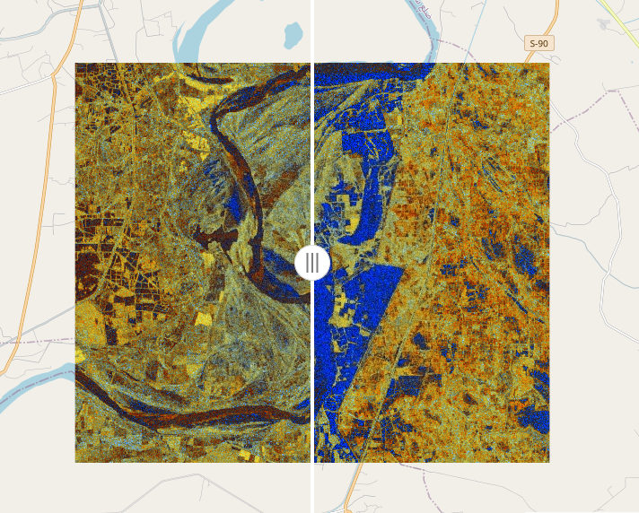

# Pakistan Flood Extent Explorer

An interactive Sentinel-1 flood imagery explorer for the 2022 Indus basin floods (with the user able to choose another location and time), built with Python and Google Earth Engine. Choose two dates, compare radar mosaics over the affected area, and export the imagery for further analysis.



## What this demonstrates

Floods happen under storm clouds and at night — conditions that blind optical satellites. Sentinel-1 carries a synthetic aperture radar (SAR) that images through cloud and darkness, which makes it the workhorse sensor for flood response. This project takes that raw radar data and turns it into imagery a non-specialist can interpret and act on:

- **Comparable before/after mosaics** over any area of interest, with a swipe divider for direct visual comparison.
- **Exportable GeoTIFFs** of both epochs, clipped to your area — ready for GIS software or downstream analysis.
- **A fully scripted pipeline** — everything from data retrieval to the interactive viewer is Python, so the whole analysis is traceable, defensible, and reproducible. Change a date, redraw the area, rerun: the result updates on demand.

The default area of interest is a polygon in Sindh, Pakistan, one of the provinces worst affected by the 2022 monsoon floods.

**Important:** this is an exploratory and visualisation tool, not a flood-warning or operational mapping product.

## Using the explorer

1. Run the app (see below) and connect to Earth Engine.
2. Compare the default pre-flood and flood mosaics over Sindh using the vertical swipe divider, or
3. Draw your own rectangle or polygon anywhere on the map.
4. Search for available mosaic end dates, then pick two dates at least 60 days apart on the same orbit track.
5. Run the comparison and, optionally, download both clipped three-band mosaics as GeoTIFFs in a ZIP archive.

The GeoTIFF download is intended for small areas of interest; Earth Engine limits the size of direct image downloads. If an export fails due to size, draw a smaller area and try again.

## How it works

Each mosaic is assembled from same-track Sentinel-1 scenes acquired in the 60 days ending on its selected date, with the newest valid observation used at each pixel to fill gaps between scene footprints. This improves spatial coverage, with a trade-off documented below.

Each mosaic is served as a three-band composite that includes a cross-polarisation difference band, computed as

```
(VH - VV) / 10
```

smooth water surfaces act as specular (mirror-like) reflectors and suppress radar backscatter — strongly so for the cross-polarised VH channel — so the VH−VV difference separates open water from land surfaces and is a robust, widely used signal for surface water extent. A full account of the processing sequence and interpretation guidance is in the [methods note](docs/methods.md).

## Data notes and limitations

- **A mosaic is not a single-date snapshot.** Because each mosaic composites up to 60 days of acquisitions, "flood extent" visible in the comparison reflects water present at any time in each window, not exactly at the chosen end date. Compare mosaics 60+ days apart, on the same orbit track, to keep the windows disjoint.
- Radar backscatter is affected by more than water: wind roughening of open water can raise backscatter and mask flood signature, while flooded vegetation can scatter strongly and hide inundation. Interpret with these effects in mind — the methods note covers interpretation guidance.
- Large downloads are capped by Earth Engine; keep export areas modest.

## Running locally

Requirements: Python, a Google account with Earth Engine access, and a Google Cloud project registered for Earth Engine. Review Google's [Earth Engine access setup](https://developers.google.com/earth-engine/guides/access) and [Python installation guide](https://developers.google.com/earth-engine/guides/python_install) first.

Install dependencies:

```
pip install -r requirements.txt
```

Configure your Earth Engine project either in the app after launch, or via a `.env` file (copy `.env.example` to `.env`):

```
GEE_PROJECT=your-cloud-project-id
```

Start the app:

```
streamlit run src/flood_mapper/app.py
```

If you did not set `GEE_PROJECT`, enter the Cloud project ID in the app, then select **Connect to Earth Engine**. Authentication is performed in the terminal, not the browser. The app reports an initialisation error if the account or project is not configured correctly.

## Project layout

```
.
├── docs/                # Design notes and methods documentation
├── src/flood_mapper/    # Streamlit app and Earth Engine/data helpers
├── tests/               # Focused tests for area-of-interest handling
├── .env.example         # Template for local configuration
├── pyproject.toml
└── requirements.txt
```

## Author

Built by Damien O'Grady — remote sensing and GIS consultant. This project builds on [earlier published work](https://hess.copernicus.org/articles/15/3475/2011/)\* mapping floods with ENVISAT ASAR data.

## Licence

This project is released under the [MIT Licence](LICENSE).

## Reference

\* **O’Grady, D., Leblanc, M., & Gillieson, D. (2011)**. *Use of ENVISAT ASAR
Global Monitoring Mode to complement optical data in the mapping of rapid
broad-scale flooding in Pakistan*. Hydrology and Earth System Sciences, 15,
3475–3794. doi:10.5194/hess-15-3475-2011